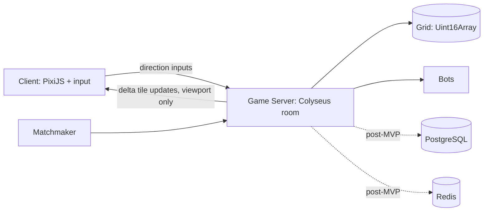

# Territory Capture

A real-time multiplayer browser game in the style of paper.io. Players roam a shared grid, draw trails outside their own land, and close loops to claim territory, while avoiding opponents who can kill them by touching their trail.

---

## Problem Statement

Casual browser games often need long onboarding, heavy downloads, or complicated rules, which makes drop-in play hard. At the same time, real-time multiplayer games are difficult to build well: they need fair server-side logic, low latency, and bandwidth that scales to many players.

Territory Capture addresses both. It offers a game whose rules can be understood in seconds, and it serves as a practical, well-scoped example of building a **server-authoritative multiplayer game** with solid netcode, rendering, and scaling.

## Objectives

- Build a playable, drop-in multiplayer territory-claiming game that runs in the browser.
- Keep the server authoritative so clients cannot cheat (clients send only direction inputs).
- Make controls feel instant using client-side prediction and interpolation.
- Keep bandwidth low with viewport culling and delta updates.
- Keep rooms always lively through bots and quick matchmaking.
- Ship an MVP in 2-3 weeks, then expand with accounts, skins, and team modes.

## Features

**Core gameplay**
- Continuous movement in four directions on a shared tile grid
- Trail drawn while outside your own territory
- Loop closing: flood fill claims all enclosed tiles
- Kill logic: touching another player's trail kills them and releases their land
- Win condition: highest territory percentage or a timed round with a leaderboard

**Multiplayer and backend**
- Server-authoritative tick loop (10-20 Hz)
- Rooms of 20-50 players on 200x200 to 400x400 maps
- Bots to fill empty slots
- Delta updates with run-length encoding, plus viewport culling
- Anti-cheat: input validation and rate limiting, no client-supplied positions

**Frontend and polish**
- PixiJS (or Canvas) rendering with an offscreen territory layer
- Interpolation for other players, local prediction for your own avatar
- Claim animations, trail glow, kill particles, screen shake, sound
- Minimap, live leaderboard, territory percentage, respawn screen
- Keyboard and swipe/joystick controls

**Progression (post-MVP)**
- Cosmetic skins and trail effects
- Daily and weekly leaderboards
- Optional login with guest play
- 2v2 / 3v3 team modes

## Technologies Used

| Layer | Technology |
|---|---|
| Server runtime | Node.js |
| Game server framework | Colyseus |
| Language | TypeScript |
| Client rendering | PixiJS (Canvas as an alternative) |
| Game state | Flat typed array (`Uint16Array`) holding an owner ID per tile |
| Persistence (post-MVP) | PostgreSQL (accounts, stats, skins) |
| Sessions and leaderboards (post-MVP) | Redis |
| Networking | WebSockets with delta + run-length-encoded updates |

## System Architecture



**Key design points**
- The server owns the grid, trails, and collisions. Clients never send positions.
- Flood fill runs only on the bounding box of the new loop, keeping cost low on large maps.
- Rooms are independent, so they scale horizontally. One Node process can host many rooms, and the matchmaker routes players to the least-full room.

## Installation / Setup

> The steps below assume the proposed project structure in the next section. Adjust script names to match your actual `package.json` files.

### Prerequisites
- Node.js 18 or later
- npm (or pnpm / yarn)
- Git

### Steps

```bash
# 1. Clone the repository
git clone <your-repo-url>
cd territory-capture

# 2. Install server dependencies
cd server
npm install

# 3. Install client dependencies
cd ../client
npm install

# 4. Start the game server (default: ws://localhost:2567)
cd ../server
npm run dev

# 5. In a new terminal, start the client (default: http://localhost:5173)
cd ../client
npm run dev
```

Open the client URL in your browser. Open it in several tabs to simulate multiple players.

### Configuration (optional)

Create a `.env` file in `server/`:

```env
PORT=2567
TICK_RATE=15
MAP_WIDTH=200
MAP_HEIGHT=200
MAX_PLAYERS_PER_ROOM=20
BOT_FILL=true
```

Post-MVP, add `DATABASE_URL` (PostgreSQL) and `REDIS_URL`.

## Usage

1. Open the game in your browser and enter a nickname (guest play, no login needed).
2. You spawn inside a small patch of your own territory.
3. Move out of your territory to start drawing a trail.
4. Return to your own land to close the loop and claim everything enclosed.
5. Avoid other players touching your trail, and try to cut theirs.
6. If you are killed, use the respawn screen to rejoin.

**Controls**

| Platform | Input |
|---|---|
| Desktop | Arrow keys or WASD |
| Mobile | Swipe or on-screen joystick |

**Strategy tip:** bigger loops give more land but expose a longer trail. Balance risk and reward.

## Project Structure

Proposed layout:

```
territory-capture/
├── README.md
├── server/
│   ├── package.json
│   ├── src/
│   │   ├── index.ts              # Server entry point
│   │   ├── rooms/
│   │   │   └── GameRoom.ts       # Room lifecycle, tick loop, input handling
│   │   ├── game/
│   │   │   ├── Grid.ts           # Uint16Array ownership grid
│   │   │   ├── Player.ts         # Player state, trail, position
│   │   │   ├── floodFill.ts      # Bounding-box flood fill for claims
│   │   │   ├── collisions.ts     # Trail and kill detection
│   │   │   └── Bot.ts            # Simple bot AI
│   │   ├── net/
│   │   │   ├── delta.ts          # Changed-tile diffing
│   │   │   └── rle.ts            # Run-length encoding
│   │   └── matchmaker.ts         # Routes players to the least-full room
│   └── .env
├── client/
│   ├── package.json
│   ├── index.html
│   └── src/
│       ├── main.ts               # Client entry point
│       ├── network/              # Connection and message handling
│       ├── render/               # PixiJS scene, territory layer, effects
│       ├── input/                # Keyboard and swipe/joystick
│       ├── prediction/           # Local movement prediction and interpolation
│       └── ui/                   # Minimap, leaderboard, respawn screen
├── shared/
│   └── constants.ts              # Tick rate, map size, message types
└── docs/
    └── screenshots/
```

## Screenshots / Demo

> Add images to `docs/screenshots/` and update the paths below.

| Gameplay | Claiming territory |
|---|---|
|  |  |

| Leaderboard and minimap | Respawn screen |
|---|---|
|  |  |

Live demo: _add link here once deployed_

## Team Members and Contributions

| Name | Role | Contributions |
|---|---|---|
| _Member 1_ | Backend lead | Tick loop, claim and kill logic, flood fill |
| _Member 2_ | Frontend lead | PixiJS rendering, interpolation, prediction |
| _Member 3_ | Networking | Delta updates, RLE, viewport culling, matchmaking |
| _Member 4_ | UI/UX and QA | Minimap, leaderboard, respawn flow, bots, playtesting |

> Replace the placeholders with your actual team and roles.

## Suggested MVP Scope (2-3 weeks)

- [ ] Single room, one map, 10-20 players, keyboard controls
- [ ] Server-authoritative tick loop with claim and kill logic
- [ ] Basic rendering with interpolation and a live leaderboard
- [ ] Simple bots and a respawn flow
- [ ] Deploy, playtest, and tune

## Known Challenges

- **Latency fairness:** a trail kill decided by one tick can feel unfair. Tune the tick rate and add a small grace window.
- **Bandwidth on large maps:** handled with viewport culling and delta compression.
- **Balance:** prevent runaway leaders by capping speed advantages or shrinking the map over time.
- **Empty lobbies:** solved with bots and quick matchmaking.

## Future Enhancements

- User accounts, persistent stats, and cosmetic skins (PostgreSQL)
- Live and daily/weekly leaderboards (Redis)
- Multiple rooms with horizontal scaling and a smarter matchmaker
- Mobile-optimized controls and UI
- Team modes (2v2, 3v3) with shared territory
- Unlockable trail effects and rewards for playtime
- Spectator mode and replays
- Map variants and shrinking-map rounds for balance

## License

Add your license here (for example, MIT).
