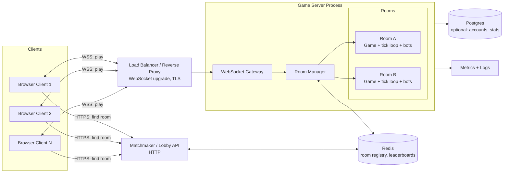
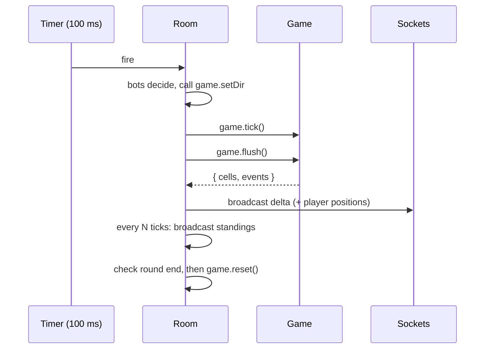

# Territory Capture Game: Architecture Design

A real-time multiplayer territory game (paper.io style). Players claim tiles on a grid, draw trails when they leave their land, and eliminate opponents by cutting their trails.

This design is built around the existing `Game` class (the pure rules engine), which has no networking and no timers. Everything else in this document wraps that engine.

---

## 1. Goals and constraints

| Goal | How the design meets it |
|---|---|
| Fair play, no cheating | Server-authoritative: clients only send *intent* (a direction), never positions or results |
| Smooth feel on bad networks | Small delta updates, client-side interpolation, input queueing |
| Many players overall | One independent room per `Game` instance; scale by adding rooms and processes |
| Easy to test and debug | Engine is pure and deterministic with a seeded RNG |
| Cheap to run | 60x60 grid, about 10 ticks/s, 12 players per room: very low CPU and bandwidth |

**Non-goals (v1):** accounts with persistent progression, cross-region play, spectator mode.

---

## 2. High-level architecture



**Layers, from inside out:**

1. **Engine** (`Game`): rules only. Cells, players, ticks, captures, kills.
2. **Room**: owns one `Game`, a timer that calls `tick()`, the connected sockets, and the bots.
3. **Gateway / Room Manager**: accepts connections, validates messages, routes players to rooms.
4. **Matchmaker / Lobby API**: decides which room a new player joins.
5. **Persistence and observability**: optional stores plus metrics.

---

## 3. Components

### 3.1 Engine: `Game` (already written)

Responsibilities:

- Owns `owner[]`, `trail[]`, `counts[]` as flat typed arrays
- `tick()` advances one step (respawns, moves, collisions, captures, wipe-outs)
- `setDir(id, d)` is the **only** way input affects the world
- `flush()` returns `{ cells, events }`, the delta since the last call
- `standings()` returns the leaderboard
- `reset()` starts a new round

Rules for keeping it healthy:

- **No I/O inside the engine.** No sockets, no `setInterval`, no `Date.now()`.
- Inject the RNG (`mulberry32(seed)`) so any match can be replayed from `seed + inputs`.
- All map writes go through `setOwner` / `setTrail` so counts and change-tracking stay correct.

### 3.2 Room

A `Room` is a thin wrapper that connects the engine to the outside world.

```
Room
 |- game: Game
 |- sockets: Map<playerId, WebSocket>
 |- bots: BotController[]
 |- timer: setInterval(tick, 100ms)
 |- state: 'lobby' | 'running' | 'ended'
 |- roundEndsAt: timestamp
```

Per-tick pipeline (runs on the server only):



### 3.3 Gateway (WebSocket server)

- Upgrades HTTP to WebSocket and assigns a **small integer player id** (1 to 12). The engine stores ids in `Uint8Array`, so ids must be below 256, and `counts` is sized `MAX_PLAYERS + 1`.
- Parses and **validates** every inbound message, with a max size and a schema check.
- Applies per-connection **rate limits** (for example, 30 messages/s).
- Maps `socket -> (room, playerId)` and cleans up on disconnect (`removePlayer`).

### 3.4 Room Manager

- Creates rooms on demand and destroys empty ones after a grace period.
- Enforces `MAX_PLAYERS` per room.
- Fills empty slots with **bots** so a room never feels dead, and removes bots as humans join.
- Publishes room status (player count, state) to Redis so the matchmaker can see it.

### 3.5 Matchmaker / Lobby API

Simple HTTP endpoint: `POST /join -> { wsUrl, roomId, token }`.

Selection logic:

1. Prefer a running room with free slots and the fewest bots.
2. Otherwise ask a game server with spare capacity to create a new room.
3. Return a short-lived signed token that the WebSocket handshake verifies.

### 3.6 Bots

Bots are regular players with `bot = true` and an AI controller that calls `setDir` just like a human would. Because they use the same entry point, they obey exactly the same rules, which is also what makes them useful for load testing.

---

## 4. Network protocol

Transport: **WebSocket** (TCP). That is fine for a 10 Hz game, and it avoids the complexity of WebRTC/UDP.

### 4.1 Client to server (intent only)

| Message | Payload | Notes |
|---|---|---|
| `join` | `{ name, token }` | First message after connect |
| `dir` | `{ d: 0..3 }` | Calls `game.setDir(id, d)` |
| `ping` | `{ t }` | For RTT measurement |

The client **never** sends position, score, kills, or territory.

### 4.2 Server to client

| Message | When | Payload |
|---|---|---|
| `welcome` | After join | `{ you, w, h, seed? }` |
| `snapshot` | After join / reconnect | Full `owner[]` + `trail[]` (3,600 bytes each at 60x60) + player list |
| `delta` | Every tick | `cells: [index, owner, trail, ...]` + `events[]` + player positions |
| `standings` | Every ~1 s | Top N list from `standings()` |
| `pong` | Reply to ping | `{ t }` |

`delta.cells` is a direct pass-through of `game.flush()`. This is why the engine tracks a `changed` set: bandwidth scales with *activity*, not map size.

### 4.3 Bandwidth estimate

- Full snapshot: about 7.2 KB, sent once per join.
- Typical delta: a few dozen changed cells x 3 numbers + player positions, roughly 200 bytes to 1 KB per tick.
- At 10 Hz x 12 players: about 25 to 120 KB/s per room outbound. Binary encoding (see section 9) can cut this by half or more.

---

## 5. Client architecture

```
Client
 |- Net: WebSocket wrapper, reconnect, message decode
 |- State: local copy of owner[], trail[], players[], standings
 |- Input: keyboard/touch -> dir messages (with local debounce)
 |- Renderer: Canvas 2D, draws state each animation frame
 |- Effects: particles/sounds driven by events (kill, capture, spawn)
 |- UI: leaderboard, minimap, death screen, name entry
```

### 5.1 Rendering loop vs network loop

These are **decoupled**:

- The network loop applies deltas to local arrays whenever messages arrive (about 10 Hz).
- The render loop runs at the display rate (60 FPS) and **interpolates** each player's drawn position between their previous and current tile, so movement looks smooth even though the server moves in discrete steps.

### 5.2 Prediction (optional, light)

Because the game is tile-stepped and slow, heavy prediction is unnecessary. A cheap improvement: when the player presses a key, **immediately rotate the local player's sprite/direction** and send the `dir` message. The authoritative position still comes from the server, so there is nothing to roll back.

### 5.3 Reconnect

On disconnect the client reconnects with its token. The server can hold the player for a few seconds (the trail stays on the map), then sends a fresh `snapshot`. If the grace period expires, the player is removed.

---

## 6. Game loop and timing

- **Tick rate:** 10 Hz (100 ms) is a good starting point. It is easy to raise or lower (the original game feel is around 8 to 12 Hz).
- Use a **drift-correcting timer**: schedule the next tick based on a target timestamp rather than a fixed `setInterval`, so slow ticks don't accumulate delay.
- Round length (for example 3 to 5 minutes): when time is up, show the final standings, wait a few seconds, then call `game.reset()` and broadcast a new `snapshot`.
- Respawn is already handled inside the engine via `RESPAWN_TICKS` (30 ticks = 3 s at 10 Hz).

---

## 7. Scaling strategy

**Unit of scale = the room.** Each room is fully independent: its own `Game`, timer, and sockets, with no shared mutable state between rooms.

| Stage | Approach |
|---|---|
| Single machine | One Node process handles many rooms (each tick is tiny) |
| Multi-core | One process per core; the matchmaker spreads rooms across them |
| Multi-machine | Several game servers behind a load balancer; **sticky routing** by `roomId` so every player in a room reaches the same process |
| Global | Regional clusters; the matchmaker picks the closest region by latency |

Capacity thinking: a 60x60 room at 10 Hz is mostly idle CPU. The costliest operations are `capture`/`kill`, which loop the full map (3,600 cells). That is fine at this size. If you later raise the grid size or player count, track cell lists per player instead of scanning the whole map.

---

## 8. Data and persistence

For v1, **no database is required**. Game state lives in memory and dies with the room.

| Data | Store | Why |
|---|---|---|
| Live game state | In-process memory | Fastest; rebuilt each round |
| Room registry and player counts | Redis | Lets the matchmaker route players |
| Global / daily leaderboard | Redis sorted set | `ZADD` / `ZREVRANGE` fit this exactly |
| Accounts, lifetime stats (later) | Postgres | Durable and queryable |
| Match replays (later) | Object storage | Store `seed + input log`; the deterministic engine can regenerate the match |

---

## 9. Security and anti-cheat

Server-authoritative design already prevents most cheating, because the client cannot claim land or move itself. Additional measures:

- **Validate everything:** the engine's `setDir` already rejects non-integers and out-of-range values. The gateway adds size limits and schema checks.
- **Rate limit** inputs and connections per IP.
- **Input queue cap:** the engine allows at most 3 queued turns, so spamming keys can't produce extra speed.
- **Signed join tokens** prevent room hopping and spoofed identities.
- **Name sanitization** (length, allowed characters, profanity filter) before it reaches other players' screens.
- **Never trust client timestamps.**

Optimization to consider later: encode `delta` in a **binary format** (for example, one byte for owner, one for trail, and a varint for the index) instead of JSON.

---

## 10. Testing strategy

| Level | What to test | How |
|---|---|---|
| Unit | Capture fills enclosed area, self-collision kills, enclosed enemy trail kills, queue rejects reversals, counts stay consistent | Call `Game` methods directly with `mulberry32(seed)` |
| Simulation | No crashes or invariant violations over thousands of ticks | Run 12 bots for 100k ticks; assert `sum(counts) == number of owned cells` |
| Protocol | Server rejects malformed messages | Fuzz the gateway |
| Load | Rooms per machine, p99 tick time | Spawn many bot-only rooms and measure |
| Replay | Same seed and inputs give the same final state | Record inputs, replay, compare arrays |

---

## 11. Observability

Metrics to export:

- Tick duration (p50 / p99). **Alert if tick time approaches the tick interval.**
- Rooms, players and bots online
- Messages in/out per second and bytes per second
- Disconnect rate and reconnect success rate
- Average round length and kills per round

Structured logs should carry `roomId` and `playerId` on every line.

---

## 12. Deployment

- Containerize the game server and the matchmaker separately.
- Run game servers on VMs or a container platform with **WebSocket-friendly, long-lived connections** (avoid platforms with short request timeouts).
- Use rolling deploys with **drain mode**: stop sending new players to a server, let its rooms finish the current round, then shut it down.
- Health endpoint: `GET /healthz` (process up, event loop lag below threshold).

---

## 13. Suggested folder layout

```
/shared
  game.js            # the pure engine (used by server, tests, optionally client)
  protocol.js        # message types and encode/decode
/server
  index.js           # HTTP + WebSocket bootstrap
  gateway.js         # connection handling, validation, rate limits
  roomManager.js
  room.js            # tick loop, broadcast, round lifecycle
  bots.js
/matchmaker
  index.js           # /join endpoint, Redis integration
/client
  index.html
  net.js
  state.js
  input.js
  render.js
  ui.js
/tests
  game.test.js
  simulation.test.js
  protocol.test.js
```

Putting `game.js` in `/shared` means the **same rules code** can run on the server (authoritative) and optionally in the browser (for local prediction or an offline practice mode).

---

## 14. Roadmap

1. **MVP:** one room, one server, JSON protocol, bots, canvas client.
2. **Polish:** interpolation, sounds, particles driven by `events`, mobile touch controls.
3. **Multi-room:** room manager, matchmaker, Redis registry.
4. **Hardening:** rate limits, signed tokens, binary protocol, load tests.
5. **Meta:** accounts, persistent stats, global leaderboard, replays.

---

## 15. Appendix: how this design adapts to your other game ideas

The same skeleton (pure engine, room per match, authoritative server, delta broadcast) applies to all of them. What changes is the engine and the netcode difficulty.

| Game idea | What changes | Hardest networking problem |
|---|---|---|
| **Top-down arena shooter** | Higher tick rate (20 to 60 Hz), continuous movement, projectiles | Client prediction, reconciliation, lag compensation for hits |
| **Co-op dungeon crawler** | Procedural generation from a shared seed, persistent characters in a DB, enemy AI on the server | State size and persistence; room-based matchmaking |
| **Territory capture** (this doc) | Discrete grid, low tick rate | Mostly efficient deltas; the easiest to scale |
| **Tower defense** | Turn-light: send *commands* (build, upgrade, send wave) instead of continuous input | Keeping two clients' simulations in sync; polish and balance matter more than netcode |
| **Social deduction** | Phase state machine (lobby, tasks, meeting, voting), hidden roles, chat | Never leak hidden info: send each player only what they should know |
| **Racing / kart** | Physics, ghost replays, time-trial leaderboards | Interpolation and snapshot smoothing at speed |
| **Card/board hybrid with arena** | Deck persistence, rating-based matchmaking, replays | Backend: data model, matchmaking by rating, deterministic replays |

If you pick one of these next, tell me which and I can write its architecture file in the same format.
